

<picture><source media="(prefers-color-scheme: dark)" srcset="assets/hero-dark.svg"></picture>

<a href="mailto:baishanmumu@gmail.com"><picture><source media="(prefers-color-scheme: dark)" srcset="assets/c-email-dark.svg">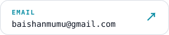</picture></a>
<a href="https://x.com/baishanmumu"><picture><source media="(prefers-color-scheme: dark)" srcset="assets/c-x-dark.svg">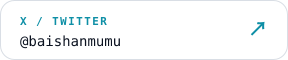</picture></a>
<a href="https://t.me/baishanmumu"><picture><source media="(prefers-color-scheme: dark)" srcset="assets/c-tg-dark.svg">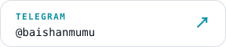</picture></a>

<picture><source media="(prefers-color-scheme: dark)" srcset="assets/h01-dark.svg"></picture>

<picture><source media="(prefers-color-scheme: dark)" srcset="assets/now-dark.svg"></picture>

<picture><source media="(prefers-color-scheme: dark)" srcset="assets/h02-dark.svg"></picture>

<picture><source media="(prefers-color-scheme: dark)" srcset="assets/whatido-dark.svg">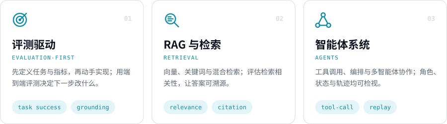</picture>

<picture><source media="(prefers-color-scheme: dark)" srcset="assets/h03-dark.svg"></picture>

<picture><source media="(prefers-color-scheme: dark)" srcset="assets/loop-dark.svg">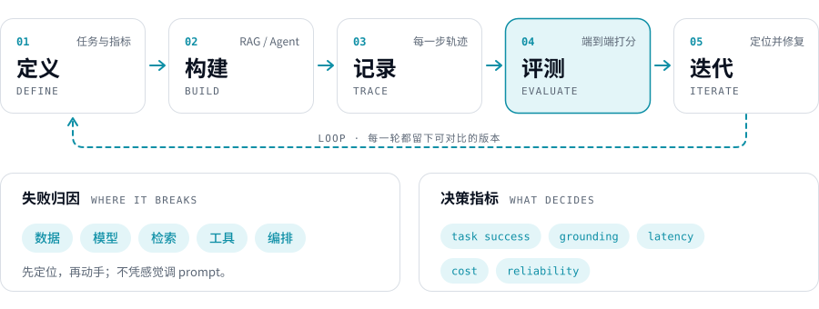</picture>

<picture><source media="(prefers-color-scheme: dark)" srcset="assets/h04-dark.svg"></picture>

<picture><source media="(prefers-color-scheme: dark)" srcset="assets/radar-dark.svg"></picture>

<picture><source media="(prefers-color-scheme: dark)" srcset="assets/signals-dark.svg"></picture>

<a href="https://arxiv.org/search/?query=LLM+agent+evaluation&searchtype=all&order=-announced_date_first"><picture><source media="(prefers-color-scheme: dark)" srcset="assets/feed-01-dark.svg">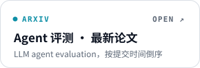</picture></a> <a href="https://arxiv.org/search/?query=retrieval-augmented+generation&searchtype=all&order=-announced_date_first"><picture><source media="(prefers-color-scheme: dark)" srcset="assets/feed-02-dark.svg">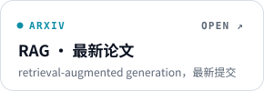</picture></a> <a href="https://arxiv.org/search/?query=multi-agent+LLM&searchtype=all&order=-announced_date_first"><picture><source media="(prefers-color-scheme: dark)" srcset="assets/feed-03-dark.svg">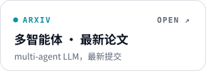</picture></a> 
<a href="https://hn.algolia.com/?dateRange=pastWeek&page=0&prefix=false&query=LLM%20agents&sort=byPopularity&type=story"><picture><source media="(prefers-color-scheme: dark)" srcset="assets/feed-04-dark.svg"></picture></a> <a href="https://github.com/search?q=agent+evaluation&type=repositories&s=updated&o=desc"><picture><source media="(prefers-color-scheme: dark)" srcset="assets/feed-05-dark.svg">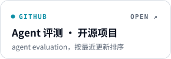</picture></a> <a href="https://huggingface.co/models?pipeline_tag=text-generation&sort=trending"><picture><source media="(prefers-color-scheme: dark)" srcset="assets/feed-06-dark.svg"></picture></a>

**信息源**

| 层 | 来源 |
|---|---|
| 01 官方一手 | [Anthropic News](https://www.anthropic.com/news) · [OpenAI News](https://openai.com/news/) · [Google DeepMind](https://deepmind.google) · [Hugging Face Blog](https://huggingface.co/blog) |
| 02 研究论文 | [arXiv cs.CL](https://arxiv.org/list/cs.CL/recent) · [arXiv cs.AI](https://arxiv.org/list/cs.AI/recent) · [HF Daily Papers](https://huggingface.co/papers) |
| 03 榜单评测 | [Arena](https://arena.ai) · [Artificial Analysis](https://artificialanalysis.ai) · [SWE-bench](https://www.swebench.com) · [OpenRouter Rankings](https://openrouter.ai/rankings) · [HELM](https://crfm.stanford.edu/helm/) · [Inspect AI](https://inspect.aisi.org.uk) |
| 04 开源工程 | [GitHub Trending](https://github.com/trending) · [Topic: llm](https://github.com/topics/llm) · [MCP](https://modelcontextprotocol.io) · [OTel GenAI 语义约定](https://github.com/open-telemetry/semantic-conventions-genai) |
| 05 社区周刊 | [Hacker News](https://news.ycombinator.com) · [Latent Space](https://www.latent.space) · [Simon Willison](https://simonwillison.net) · [The Batch](https://www.deeplearning.ai/the-batch/) · [Import AI](https://importai.substack.com/archive) |

<picture><source media="(prefers-color-scheme: dark)" srcset="assets/h05-dark.svg"></picture>

<picture><source media="(prefers-color-scheme: dark)" srcset="assets/stk/g0-dark.svg"></picture> 
<a href="https://www.python.org"><picture><source media="(prefers-color-scheme: dark)" srcset="assets/stk/python-dark.svg">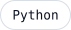</picture></a> <a href="https://pytorch.org"><picture><source media="(prefers-color-scheme: dark)" srcset="assets/stk/pytorch-dark.svg"></picture></a> <a href="https://huggingface.co/docs/transformers"><picture><source media="(prefers-color-scheme: dark)" srcset="assets/stk/transformers-dark.svg"></picture></a> <a href="https://scikit-learn.org"><picture><source media="(prefers-color-scheme: dark)" srcset="assets/stk/scikit-learn-dark.svg"></picture></a> <a href="https://onnxruntime.ai"><picture><source media="(prefers-color-scheme: dark)" srcset="assets/stk/onnx-runtime-dark.svg"></picture></a>

<picture><source media="(prefers-color-scheme: dark)" srcset="assets/stk/g1-dark.svg"></picture> 
<a href="https://openai.com"><picture><source media="(prefers-color-scheme: dark)" srcset="assets/stk/openai-dark.svg"></picture></a> <a href="https://langchain-ai.github.io/langgraph/"><picture><source media="(prefers-color-scheme: dark)" srcset="assets/stk/langgraph-dark.svg"></picture></a> <a href="https://www.langchain.com"><picture><source media="(prefers-color-scheme: dark)" srcset="assets/stk/langchain-dark.svg"></picture></a> <a href="https://www.llamaindex.ai"><picture><source media="(prefers-color-scheme: dark)" srcset="assets/stk/llamaindex-dark.svg"></picture></a> <a href="https://dspy.ai"><picture><source media="(prefers-color-scheme: dark)" srcset="assets/stk/dspy-dark.svg"></picture></a> <a href="https://modelcontextprotocol.io"><picture><source media="(prefers-color-scheme: dark)" srcset="assets/stk/mcp-dark.svg"></picture></a> <a href="https://fastapi.tiangolo.com"><picture><source media="(prefers-color-scheme: dark)" srcset="assets/stk/fastapi-dark.svg"></picture></a>

<picture><source media="(prefers-color-scheme: dark)" srcset="assets/stk/g2-dark.svg"></picture> 
<a href="https://qdrant.tech"><picture><source media="(prefers-color-scheme: dark)" srcset="assets/stk/qdrant-dark.svg"></picture></a> <a href="https://milvus.io"><picture><source media="(prefers-color-scheme: dark)" srcset="assets/stk/milvus-dark.svg"></picture></a> <a href="https://github.com/pgvector/pgvector"><picture><source media="(prefers-color-scheme: dark)" srcset="assets/stk/pgvector-dark.svg"></picture></a> <a href="https://www.elastic.co/elasticsearch"><picture><source media="(prefers-color-scheme: dark)" srcset="assets/stk/elasticsearch-dark.svg"></picture></a> <a href="https://redis.io"><picture><source media="(prefers-color-scheme: dark)" srcset="assets/stk/redis-dark.svg"></picture></a> <a href="https://github.com/FlagOpen/FlagEmbedding"><picture><source media="(prefers-color-scheme: dark)" srcset="assets/stk/bge-dark.svg"></picture></a> <a href="https://www.sbert.net"><picture><source media="(prefers-color-scheme: dark)" srcset="assets/stk/sentence-transformers-dark.svg"></picture></a>

<picture><source media="(prefers-color-scheme: dark)" srcset="assets/stk/g3-dark.svg"></picture> 
<a href="https://langfuse.com"><picture><source media="(prefers-color-scheme: dark)" srcset="assets/stk/langfuse-dark.svg"></picture></a> <a href="https://docs.ragas.io"><picture><source media="(prefers-color-scheme: dark)" srcset="assets/stk/ragas-dark.svg"></picture></a> <a href="https://www.promptfoo.dev"><picture><source media="(prefers-color-scheme: dark)" srcset="assets/stk/promptfoo-dark.svg"></picture></a> <a href="https://mlflow.org"><picture><source media="(prefers-color-scheme: dark)" srcset="assets/stk/mlflow-dark.svg"></picture></a> <a href="https://opentelemetry.io"><picture><source media="(prefers-color-scheme: dark)" srcset="assets/stk/opentelemetry-dark.svg"></picture></a> <a href="https://prometheus.io"><picture><source media="(prefers-color-scheme: dark)" srcset="assets/stk/prometheus-dark.svg"></picture></a> <a href="https://grafana.com"><picture><source media="(prefers-color-scheme: dark)" srcset="assets/stk/grafana-dark.svg"></picture></a>

<picture><source media="(prefers-color-scheme: dark)" srcset="assets/stk/g4-dark.svg"></picture> 
<a href="https://vllm.ai"><picture><source media="(prefers-color-scheme: dark)" srcset="assets/stk/vllm-dark.svg"></picture></a> <a href="https://ollama.com"><picture><source media="(prefers-color-scheme: dark)" srcset="assets/stk/ollama-dark.svg"></picture></a> <a href="https://www.docker.com"><picture><source media="(prefers-color-scheme: dark)" srcset="assets/stk/docker-dark.svg"></picture></a> <a href="https://kubernetes.io"><picture><source media="(prefers-color-scheme: dark)" srcset="assets/stk/kubernetes-dark.svg"></picture></a>

点击任一技术，跳转其官网。

<picture><source media="(prefers-color-scheme: dark)" srcset="assets/h06-dark.svg"></picture>

<picture><source media="(prefers-color-scheme: dark)" srcset="assets/closing-dark.svg">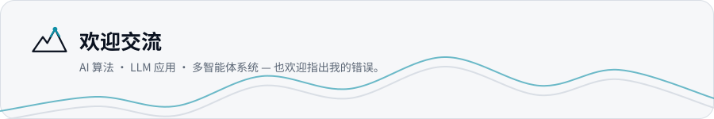</picture>

<a href="mailto:baishanmumu@gmail.com">baishanmumu@gmail.com</a> · <a href="https://x.com/baishanmumu">x.com/baishanmumu</a> · <a href="https://t.me/baishanmumu">t.me/baishanmumu</a>

