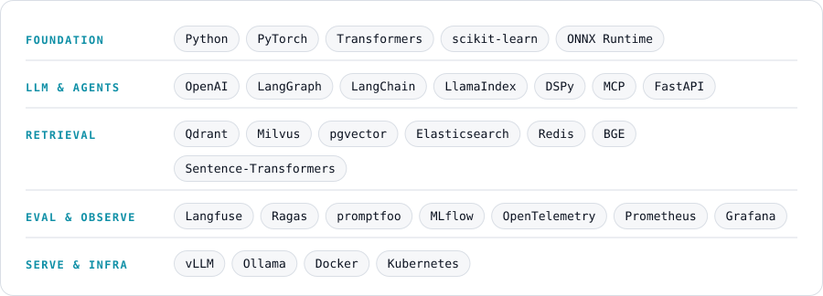

<picture><source media="(prefers-color-scheme: dark)" srcset="assets/hero-dark.svg"></picture>

<a href="mailto:baishanmumu@gmail.com"><picture><source media="(prefers-color-scheme: dark)" srcset="assets/c-email-dark.svg"></picture></a>
<a href="https://x.com/baishanmumu"><picture><source media="(prefers-color-scheme: dark)" srcset="assets/c-x-dark.svg"></picture></a>
<a href="https://t.me/baishanmumu"><picture><source media="(prefers-color-scheme: dark)" srcset="assets/c-tg-dark.svg"></picture></a>

<picture><source media="(prefers-color-scheme: dark)" srcset="assets/h01-dark.svg"></picture>

<picture><source media="(prefers-color-scheme: dark)" srcset="assets/now-dark.svg"></picture>

<picture><source media="(prefers-color-scheme: dark)" srcset="assets/h02-dark.svg"></picture>

<picture><source media="(prefers-color-scheme: dark)" srcset="assets/whatido-dark.svg"></picture>

<picture><source media="(prefers-color-scheme: dark)" srcset="assets/h03-dark.svg"></picture>

<picture><source media="(prefers-color-scheme: dark)" srcset="assets/loop-dark.svg"></picture>

<picture><source media="(prefers-color-scheme: dark)" srcset="assets/h04-dark.svg"></picture>

<picture><source media="(prefers-color-scheme: dark)" srcset="assets/radar-dark.svg"></picture>

<picture><source media="(prefers-color-scheme: dark)" srcset="assets/signals-dark.svg"></picture>

<a href="https://arxiv.org/search/?query=LLM+agent+evaluation&searchtype=all&order=-announced_date_first"><picture><source media="(prefers-color-scheme: dark)" srcset="assets/feed-01-dark.svg"></picture></a> <a href="https://arxiv.org/search/?query=retrieval-augmented+generation&searchtype=all&order=-announced_date_first"><picture><source media="(prefers-color-scheme: dark)" srcset="assets/feed-02-dark.svg"></picture></a> <a href="https://arxiv.org/search/?query=multi-agent+LLM&searchtype=all&order=-announced_date_first"><picture><source media="(prefers-color-scheme: dark)" srcset="assets/feed-03-dark.svg"></picture></a> 
<a href="https://hn.algolia.com/?dateRange=pastWeek&page=0&prefix=false&query=LLM%20agents&sort=byPopularity&type=story"><picture><source media="(prefers-color-scheme: dark)" srcset="assets/feed-04-dark.svg"></picture></a> <a href="https://github.com/search?q=agent+evaluation&type=repositories&s=updated&o=desc"><picture><source media="(prefers-color-scheme: dark)" srcset="assets/feed-05-dark.svg"></picture></a> <a href="https://huggingface.co/models?pipeline_tag=text-generation&sort=trending"><picture><source media="(prefers-color-scheme: dark)" srcset="assets/feed-06-dark.svg"></picture></a>

**信息源**

| 层 | 来源 |
|---|---|
| 01 官方一手 | [Anthropic News](https://www.anthropic.com/news) · [OpenAI News](https://openai.com/news/) · [Google DeepMind](https://deepmind.google) · [Hugging Face Blog](https://huggingface.co/blog) |
| 02 研究论文 | [arXiv cs.CL](https://arxiv.org/list/cs.CL/recent) · [arXiv cs.AI](https://arxiv.org/list/cs.AI/recent) · [HF Daily Papers](https://huggingface.co/papers) |
| 03 榜单评测 | [Arena](https://arena.ai) · [Artificial Analysis](https://artificialanalysis.ai) · [SWE-bench](https://www.swebench.com) · [OpenRouter Rankings](https://openrouter.ai/rankings) · [HELM](https://crfm.stanford.edu/helm/) · [Inspect AI](https://inspect.aisi.org.uk) |
| 04 开源工程 | [GitHub Trending](https://github.com/trending) · [Topic: llm](https://github.com/topics/llm) · [MCP](https://modelcontextprotocol.io) · [OTel GenAI 语义约定](https://github.com/open-telemetry/semantic-conventions-genai) |
| 05 社区周刊 | [Hacker News](https://news.ycombinator.com) · [Latent Space](https://www.latent.space) · [Simon Willison](https://simonwillison.net) · [The Batch](https://www.deeplearning.ai/the-batch/) · [Import AI](https://importai.substack.com/archive) |

<picture><source media="(prefers-color-scheme: dark)" srcset="assets/h05-dark.svg"></picture>

<picture><source media="(prefers-color-scheme: dark)" srcset="assets/stack-dark.svg"></picture>

技术栈官网链接

- **FOUNDATION**：[Python](https://www.python.org) · [PyTorch](https://pytorch.org) · [Transformers](https://huggingface.co/docs/transformers) · [scikit-learn](https://scikit-learn.org) · [ONNX Runtime](https://onnxruntime.ai)
- **LLM & AGENTS**：[OpenAI](https://openai.com) · [LangGraph](https://langchain-ai.github.io/langgraph/) · [LangChain](https://www.langchain.com) · [LlamaIndex](https://www.llamaindex.ai) · [DSPy](https://dspy.ai) · [MCP](https://modelcontextprotocol.io) · [FastAPI](https://fastapi.tiangolo.com)
- **RETRIEVAL**：[Qdrant](https://qdrant.tech) · [Milvus](https://milvus.io) · [pgvector](https://github.com/pgvector/pgvector) · [Elasticsearch](https://www.elastic.co/elasticsearch) · [Redis](https://redis.io) · [BGE](https://github.com/FlagOpen/FlagEmbedding) · [Sentence-Transformers](https://www.sbert.net)
- **EVAL & OBSERVE**：[Langfuse](https://langfuse.com) · [Ragas](https://docs.ragas.io) · [promptfoo](https://www.promptfoo.dev) · [MLflow](https://mlflow.org) · [OpenTelemetry](https://opentelemetry.io) · [Prometheus](https://prometheus.io) · [Grafana](https://grafana.com)
- **SERVE & INFRA**：[vLLM](https://vllm.ai) · [Ollama](https://ollama.com) · [Docker](https://www.docker.com) · [Kubernetes](https://kubernetes.io)

<picture><source media="(prefers-color-scheme: dark)" srcset="assets/h06-dark.svg"></picture>

<picture><source media="(prefers-color-scheme: dark)" srcset="assets/closing-dark.svg"></picture>

<a href="mailto:baishanmumu@gmail.com">baishanmumu@gmail.com</a> · <a href="https://x.com/baishanmumu">x.com/baishanmumu</a> · <a href="https://t.me/baishanmumu">t.me/baishanmumu</a>

